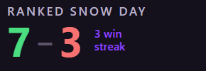

# Rocket League OBS Session Counter

An OBS overlay that keeps your **win/loss record for the current stream**, for each game mode separately. Queue Ranked 2v2, then Hoops, then back to 2v2, and each mode keeps its own record and streak.



It's a single web page you add to OBS as a browser source. It reads Rocket League's official **Stats API**, the live match feed Psyonix built into the game for overlays. It needs no mods and no installs, so it works on Epic and Steam alike.

## Setup

**1. Turn on the Stats API (once).** Rocket League ships with it switched off. In this folder, run:

```powershell
powershell -ExecutionPolicy Bypass -File .\enable-stats-api.ps1
```

The script finds your Epic and Steam installs and turns the API on. It asks for admin only if a file under Program Files needs changing. Restart Rocket League afterwards.

<details>
<summary>Or do it by hand</summary>

Open `<Rocket League folder>\TAGame\Config\DefaultStatsAPI.ini` as admin and set `PacketSendRate=20`. Any value from 1 to 120 works. Leave `WebPort=49124`. Typical install folders:

- **Epic:** `C:\Program Files\Epic Games\rocketleague`
- **Steam:** `C:\Program Files (x86)\Steam\steamapps\common\rocketleague`

</details>

**2. Add the overlay to OBS.** Download this repo (*Code → Download ZIP*, or `git clone`). In OBS, add a **Browser** source, tick **Local file**, and choose `overlay.html`. Set the size to **280 × 100**, then position it wherever suits your layout.

Play a match. The overlay appears while Rocket League is running, and it updates when each match ends.

## What it shows

- **The current mode** from the game's playlist, e.g. *Ranked 2v2*, *Casual 3v3* or *Ranked Hoops*, with that mode's wins and losses for the session.
- **A streak** once you win or lose two in a row.
- **Each mode on its own:** switching modes shows that mode's record. Switching back picks up where you left off.

## What counts

- **Counted:** matches against real players, in any online playlist or a private match. Your team is the player the game's camera follows, so it works on any of your accounts without setup.
- **Opponents who quit:** a win when opponents leave still counts.
- **Not counted:** free play, training, and matches against bots.
- **Forfeits** count as a loss. The match ends normally with the other team winning.
- **Leaving early** counts as a loss, as it does in ranked, provided the match had kicked off. If you reconnect to the same match (ranked reconnect), the loss is taken back and the real result counts instead. Add `?leaveCountsAsLoss=0` to ignore matches you leave.
- **Each stream starts at 0–0.** After 4 hours without a counted match, the next one starts a new session. The counts survive OBS restarts.

## Fixing a count

In OBS, right-click the source → **Interact**, then hover over it. Buttons appear:

- **+W, −W, +L, −L** fix the record for the mode on screen.
- **reset** starts the session over.

Viewers can see the buttons while you hover.

## Options

Add these to the end of the file path in the browser source, e.g. `overlay.html?resetAfterHours=6&alwaysShow=1`:

| Option | Default | What it does |
| --- | --- | --- |
| `leaveCountsAsLoss=0` | on | Ignore matches you leave before they end, instead of counting a loss |
| `resetAfterHours=4` | `4` | Hours without a counted match before a new session starts |
| `names=73:Heatseeker` | | Name playlists the overlay doesn't know, as comma-separated `id:name` pairs. Unknown ones show as `Playlist 73` |
| `alwaysShow=1` | off | Stay visible when Rocket League isn't running (handy for positioning) |
| `port=49124` | `49124` | Match `WebPort` in `DefaultStatsAPI.ini` |
| `debug=1` | off | Show connection and match details under the counter |

## Troubleshooting

- **Nothing shows while Rocket League is running:** the Stats API is probably off. A big game update can reset it, so run `enable-stats-api.ps1` again and restart the game.
- **A match wasn't counted:** add `?debug=1` and play a match. The status line shows whether the overlay sees the match, your team and the opponents. Each match's outcome, whether counted or skipped and why, is also kept in the browser source's local storage under `rl-session-v2-log`.

## How it works

The overlay connects to `ws://127.0.0.1:49124`, Rocket League's Stats API web socket:

- **Mode:** comes from `Game.PlaylistId` in each `UpdateState` message.
- **Your team:** comes from `Game.Target`, the player the camera follows. Goal replays are ignored.
- **The result:** comes from `MatchEnded` or `Game.bHasWinner`.

Everything stays in OBS's browser storage, and nothing is sent anywhere.

Note: Rocket League listens for Stats API connections on all network interfaces, not just localhost. On a typical home network that's harmless. If you're on a shared network, set `PacketSendRate=0` when you're not streaming.

## License

[MIT](LICENSE)
